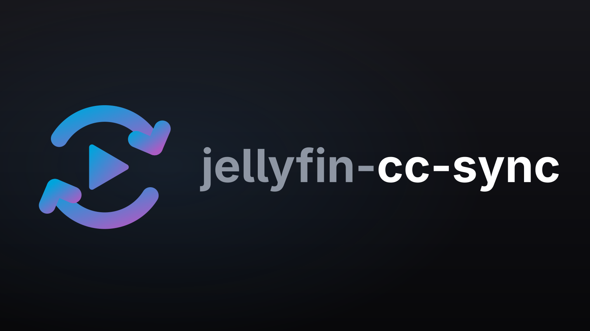

# jellyfin-sync



**jellyfin-cc-sync** is a Jellyfin server plugin that keeps one Jellyfin user in step with a
[jClipCorn](https://github.com/Mikescher/jClipCorn) database:

- **jClipCorn → Jellyfin**, every 30 minutes: watched state, play count and last-played date,
  favourites derived from the jClipCorn user score, and `jcc-*` tags for scores and groups.
- **Jellyfin → jClipCorn**, on every watch: the watch is queued as a *pending update* and
  written into jClipCorn's viewed history as soon as jClipCorn is not running.
- An exhaustive history of every change, viewable on the plugin's pages.

## Install

Dashboard → Plugins → Repositories → add:

```
https://raw.githubusercontent.com/Mikescher/jellyfin-sync/master/manifest.json
```

Then install **jellyfin-cc-sync** from the catalogue and restart the server. Requires Jellyfin
12.3 or newer and a jClipCorn database with schema 38 (main) / 3 (user data).

The jClipCorn `ClipCornDB` folder has to be visible to Jellyfin as a directory (bind mount, or a
Docker cifs/nfs volume) and writable. The plugin does not mount shares itself. See
[`docs/deployment.md`](docs/deployment.md) for setups, the NFO setting to leave empty and why the
time zone setting must match the jClipCorn machine.

First steps: Settings → set the directory and the sync user → **Test ClipCorn access** → Save.
The first sync stops before changing anything and shows its plan on the Status page; **Apply**
confirms it.

## How it works

### Matching

jClipCorn writes `<uniqueid type="clipcorn">` into every NFO; Jellyfin stores it as the
`clipcorn` provider id. That is the match key for movies, series, seasons and episodes. Movies
and series without it fall back to TMDB id, then IMDB id, then name and year; seasons and
episodes have no fallback. The Status page lists everything that did not match.

### jClipCorn is the source of truth

For the configured user, every sync overwrites Jellyfin with jClipCorn's data plus the watches
that are still waiting to be written:

| Jellyfin | from jClipCorn |
|---|---|
| Played / play count | viewed history not empty / number of entries |
| Last played | latest dated history entry (date-only entries at 12:00 local; unknown dates give no date) |
| Favourite | user score in a configurable set (default: Favourite, Masterpiece) |
| `jcc-rating-<label>` | user score, e.g. `jcc-rating-masterpiece` |
| `jcc-<group>` | groups of movies and series, e.g. `jcc-mcu` |

Every tag starting with `jcc-` belongs to the plugin: it is added or removed to match jClipCorn,
other tags are never touched. Tags are library-wide in Jellyfin, so every user sees them; watch
state and favourites are per user.

Changes made in Jellyfin to these fields are reverted by the next sync. Only watches go the
other way.

### Watches in Jellyfin

A movie or episode played by the sync user to completion (or past 90 %) becomes a pending
update carrying the playback start time. If jClipCorn is not running (no fresh
`ClipCornDB.db.~lock`), it is written 15 seconds later; otherwise a task retries every 5 minutes.
Before each write the user-data database is backed up (the last 20 copies are kept). Like
jClipCorn itself, writing a watch removes the "Watch later" tag (configurable), for an episode
also from its series. Only `ClipCornUserData.db` is ever written.

Optionally, marking an item as played by hand also creates a pending update. Marking as
unplayed is never written back.

### Safety

- jClipCorn is read from a local snapshot; a snapshot that changed while it was copied, an
  unknown schema version or a mismatched user-data file aborts the run without touching Jellyfin.
- A run that would change more than 100 items, or un-watch more than 20, stops and waits for
  confirmation on the Status page, with a preview of every change. The first run always does.
  Apply is refused when jClipCorn or the pending updates changed since the preview.
- Dry-run mode records what would change without applying it.
- A list in jClipCorn that does not parse completely is never rewritten; the element is skipped
  and listed on the Status page.
- Failures, aborts and guard stops are mirrored into Jellyfin's activity log (configurable).

## Configuration

Dashboard → Plugins → jellyfin-cc-sync. The full list with defaults is in
[`PLAN.md` §5](PLAN.md#5-configuration); the important ones:

| Setting | Default | Purpose |
|---|---|---|
| ClipCorn directory | — | Path of the `ClipCornDB` folder as Jellyfin sees it |
| ClipCorn timezone | `Europe/Berlin` | Zone of jClipCorn's local timestamps |
| Sync user | — | The Jellyfin user that is synced |
| Libraries | all | Libraries taken into account |
| Favourite scores | Favourite, Masterpiece | Scores that mark an item as favourite |
| Write watches back | on | Queue Jellyfin watches for jClipCorn |
| Manual mark creates pending | off | Also queue "mark played" |
| Reset "Watch later" | on | Remove jClipCorn's watch-later tag on write |
| Change guard | 100 / 20 | Changes / un-watches per run before confirmation is needed |

The schedules are the triggers of the two scheduled tasks *Sync jClipCorn → Jellyfin* (30 min)
and *Write pending watches to jClipCorn* (5 min) under Dashboard → Scheduled Tasks.

## Pages

- **Settings** — configuration and a *Test ClipCorn access* button.
- **Status** — lock state, last runs, pending count, match report, preview and *Apply* for
  guarded runs, *Run now* buttons.
- **Pending** — queued watches with retry and discard.
- **History** — every applied change, pending step and run summary, filterable by kind, text,
  run and date; kept forever unless a retention is set.

## Development

```sh
make build                                        # compile plugin and tests
make test                                         # unit + fixture tests (xunit.v3, Microsoft.Testing.Platform)
make deploy JELLYFIN_CONFIG=~/.config/jellyfin    # drop the dll into a local server
make package                                      # artifacts/jellyfin-cc-sync_<version>.zip
```

The tests run against a real jClipCorn database pair in
`Jellyfin.Plugin.CcSync.Tests/Fixtures/v38/`, written by jClipCorn itself; its README says how it
was generated.

### Logo

`assets/logo.svg` is generated by `scripts/make_logo.py` (needs `fonttools`, `uharfbuzz` and
Adwaita Sans); the wordmark is stored as outlines, so rendering needs no font:

```sh
python3 scripts/make_logo.py
rsvg-convert -w 1600 -h 900 assets/logo.svg -o assets/logo.png
```

### Release

```sh
make release VERSION=1.0.0.0 CHANGELOG="what changed"
git add -A && git commit -m "Release 1.0.0.0" && git push
```

The zip is committed in `releases/` and `manifest.json` points at the raw file, so zip and
checksum must be committed together.
